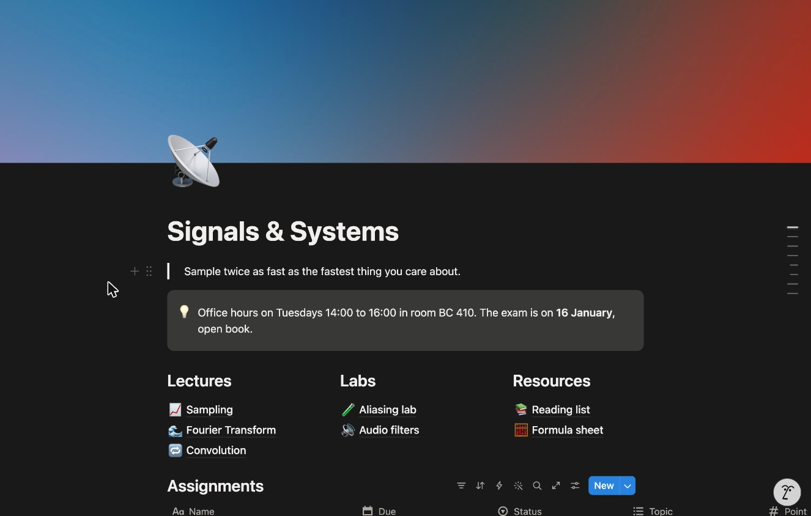
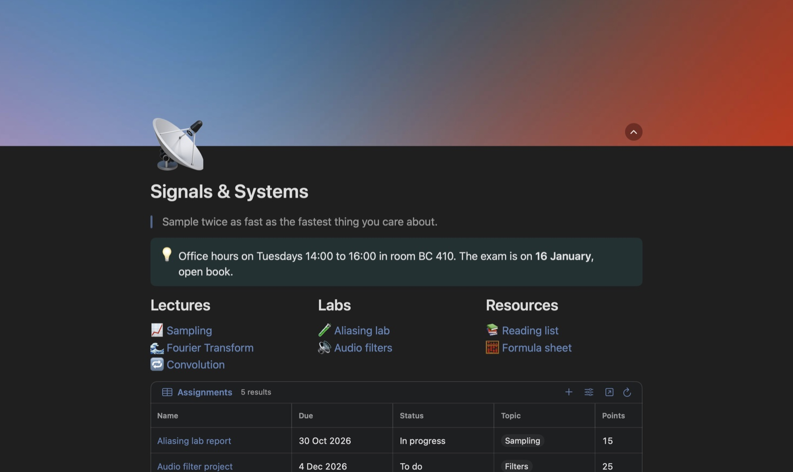
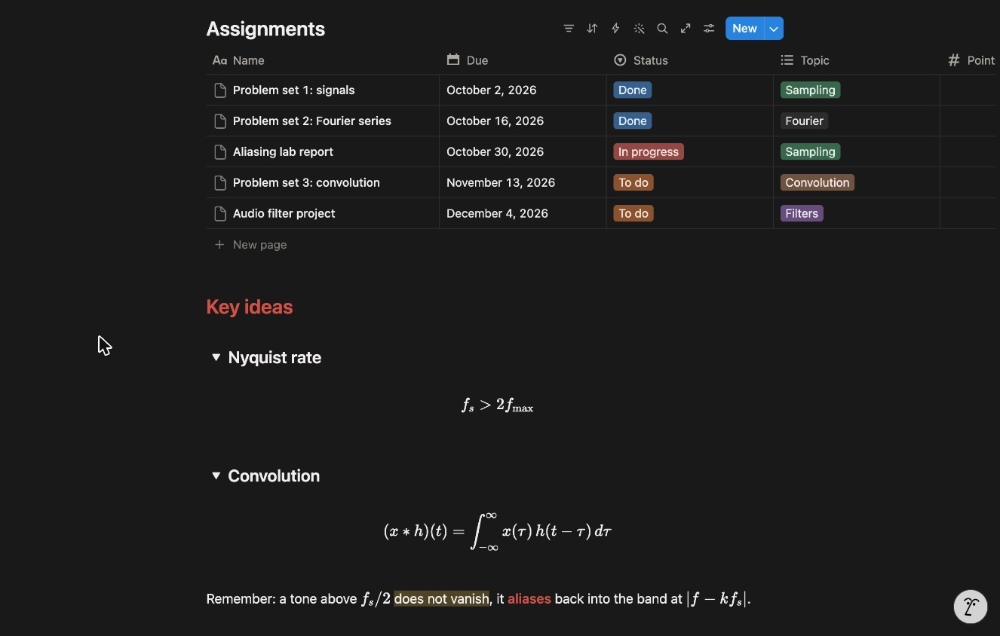
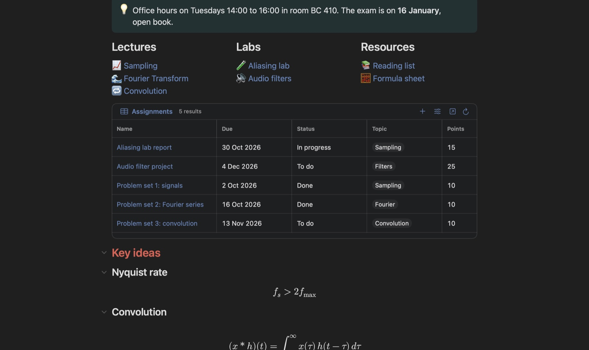
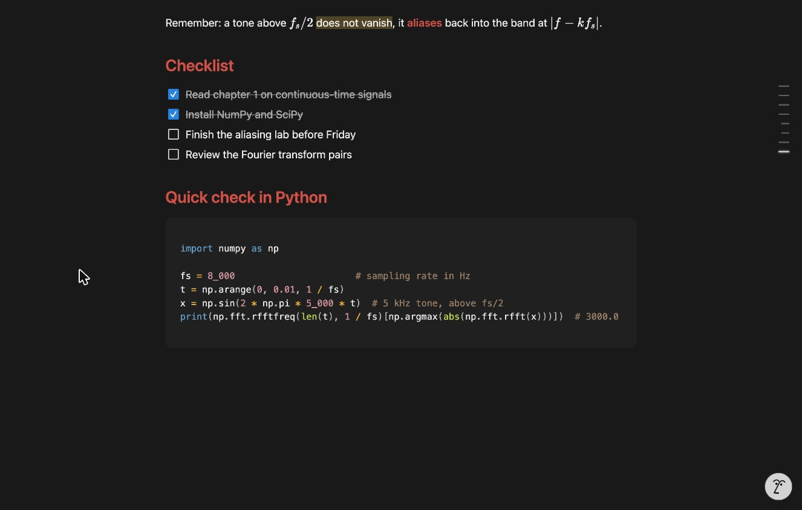
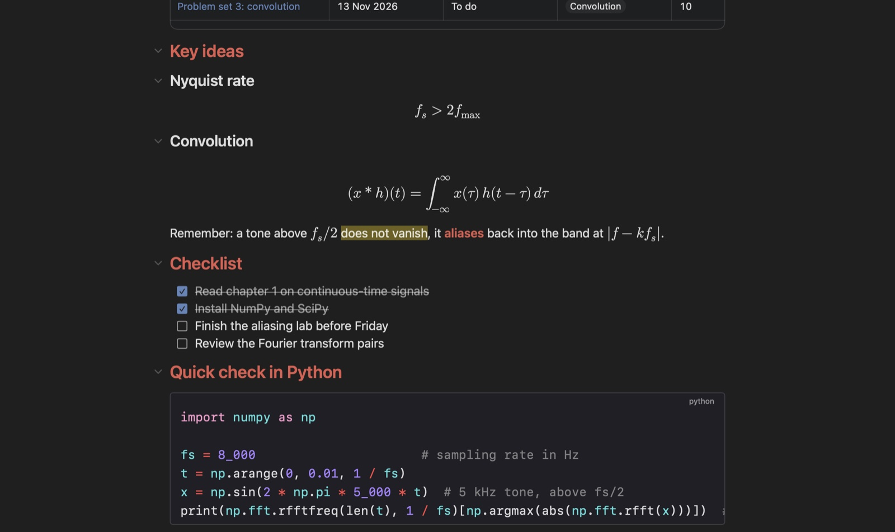
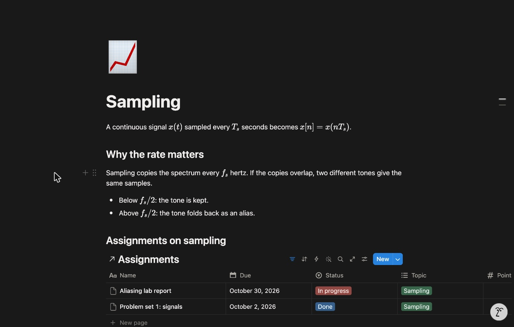
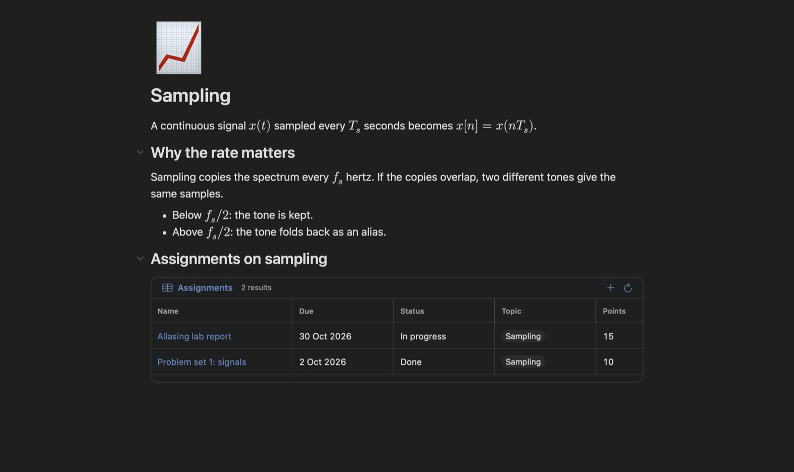
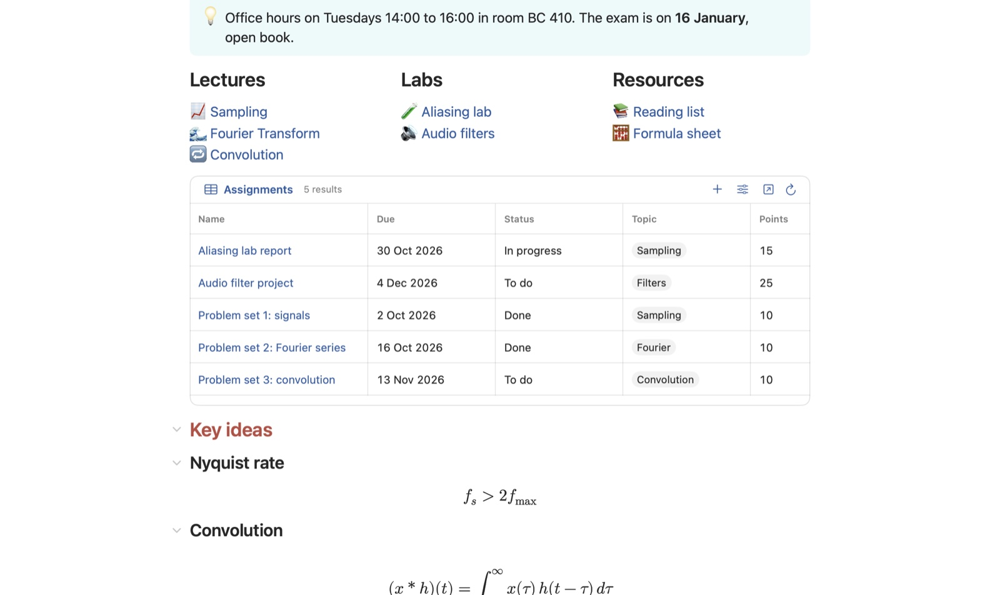

<!--
File: README.md
---------------
Layer: Documentation
Description: What the Importer is, what a Notion page looks like imported, its state, how to use it and where its plan
             lives.

Authors: Bahey Shalash
Version: 0.5
Date: 28/11/2026
-->

# Importer

Turns the exports of other note apps into an ordinary vault: Markdown notes, [Obsidian Bases](https://help.obsidian.md/bases) for databases, and attachments as files, so the result works the same in [Graphite](https://github.com/Graphite-Note/Graphite) and in Obsidian. Written in Swift with the standard library alone, and Foundation only for files on disk. It knows no app: the host gives it the export to read, the place to write and, for imports over the network, the way to send requests.

Notion comes first, from its HTML export and from its API. The other formats of Obsidian's [Importer](https://github.com/obsidianmd/obsidian-importer) follow (Evernote, Apple Notes, Bear, OneNote, Logseq, Roam, Google Keep and more).

## A Notion page, imported

Obsidian's Importer drops Notion's colors, writes a page's cover as `cover`, which neither Obsidian nor Graphite draws, and turns databases into plain pages. Here a page imports as Notion shows it: the cover and the icon (as `banner` and `icon`), columns, colored text and highlights (`~={#e05a52}…=~`, `==…==`), callouts with their icons, toggle headings that fold, equations, lists of links with each page's icon, and databases as [bases](https://help.obsidian.md/bases) with their columns in Notion's order and width, their rows by their whole titles, and their views on other pages filtered to the rows they show. The pictures show a course workspace made for the purpose, Notion on the left and the same notes in [Graphite](https://github.com/Graphite-Note/Graphite) on the right.

<p> </p>

The cover, the icon, the quote, the callout with its icon and the three columns of links, each link with its page's icon.

<p> </p>

The database as a base, a row's title with its colon kept ("Problem set 1: signals"), the red heading, the headings that fold, the equations and the highlight.

<p> </p>

A checklist and code with its language.

<p> </p>

A view of the database on another page, a base in that page showing its two rows.

<p></p>

The same notes in Graphite's light appearance: the colors are Notion's, chosen to read in both.

## State

Notion's HTML export and Notion's API import (version 0.5.1). A zip, several `Part-N` zips, a zip of zips or an unpacked folder is read entry by entry, never whole, with a DEFLATE decoder written in Swift. Pages become Markdown notes in the folders Notion nests them in, databases become [Obsidian Bases](https://help.obsidian.md/bases) over their rows, rows become notes with typed properties (added to `.obsidian/types.json`), attachments are copied in pieces next to their notes, links between pages are resolved by page identifier, and an import report note lists what was written, simplified and left out. Notion's Markdown & CSV export is refused with the reason.

Through Notion's API (since 0.3.0), with an internal integration's token that the host keeps and adds to its requests, the importer never seeing it: pages and blocks read page by page into the same notes, databases as bases with Notion's table, board, gallery and list views, their filters, sorts and groups, formulas and rollups converted to Bases formulas (with what Bases lacks reported), linked database views as views of the base they show, files Notion holds downloaded in ranges while their page is written, and Notion's limit of three requests a second kept, with waits on 429 and 5xx. Importing again into an earlier import's folder finds each note by its `notion-id`, replaces only what nobody edited since, and reports what it kept. A page's cover is its `banner` property, which Graphite and the Banners and Pixel Banner plugins draw.

The other formats come later.

Since 0.2.0 the importers (`ImporterCore`, `NotionImport`) use the Swift standard library alone, no Foundation, and the same code runs as a downloadable plugin compiled to WebAssembly (`Plugin/`): 890 KB with Embedded Swift (347 KB gzip), and it imports the test exports and real ones byte for byte as the linked package does.

[docs/Design.md](docs/Design.md) describes the design, and the plan with its open items is [Docs/Notion-import-todo.md](https://github.com/Graphite-Note/Graphite/blob/main/Docs/Notion-import-todo.md) in Graphite.

## Using it

```swift
.package(url: "https://github.com/Graphite-Note/Importer.git", exact: "0.5.1")
```

and the product `Importer` in a target's dependencies: `ImporterCore`, `NotionImport` and `ImporterFileSystem`, which reads and writes files on disk with Foundation. `PortableImporter` is the importers without `ImporterFileSystem`, for hosts with no Foundation. An import, with the host's own source and destination in place of the ones on disk:

```swift
let tree = try await ExportFileTree.reading(zipArchives: [FileRandomAccessSource(url: exportURL)],
                                            named: ["Export.zip"], temporaryStorage: MemoryTemporaryStorage())
let options = NotionHTMLImportOptions(destinationFolder: VaultPath(components: ["Notion"])!, exportName: "Export.zip",
                                      importDate: "2026-11-26", exportYear: 2026)
let result = try await NotionHTMLImporter.importExport(tree, into: FolderImportDestination(vaultFolder: vaultURL),
                                                       options: options)
```

### The `importer` command

For manual runs on real exports, the package also builds a small command. It imports into a vault folder on disk and prints the report:

```bash
swift run importer notion Export.zip --vault ~/Vault --into Notion
```

Several parts are given one after the other, an unpacked export as its folder.

## The WebAssembly plugin

`Plugin/` builds the plugin that Graphite (and Obsidian) installs from this repository's releases: a WebAssembly module of `ImporterCore` and `NotionImport` with the calls of `Plugin/Sources/ImporterWasm`, and the JavaScript around it, which reads the picked files by range and writes the vault through the plugin API. The module needs the swift.org toolchain and the Swift SDK for WebAssembly of one version (6.4.2), Xcode's toolchain cannot build it:

```bash
Plugin/build-module.sh embedded Plugin/build/importer.wasm
```

`Plugin/build-plugin.sh` writes the plugin itself (`main.js` with the module inside it, `manifest.json`, `styles.css`), and a version tag whose version `manifest.json` names publishes a release with those files (`.github/workflows/release.yml`), from which Graphite and Obsidian install it. The plugin adds the command "Import Notion's HTML export…" and a settings tab, both opening its import window: the export picked (its zip, or its parts together), the vault folder, a progress bar page by page, Stop, and the report note at the end.

`Plugin/tests/compare-with-linked.sh` imports exports with the `importer` command and with the module in Node, and checks that both vaults hold the same bytes.

## Tests

`swift test`, on macOS and Linux, run for every push with a WebAssembly build of the library targets and of the plugin's module, with Embedded Swift and with the standard library, each compared with the linked package on the test exports (`.github/workflows/tests.yml`). The Notion tests import Obsidian Importer's own test exports and API fixtures (`Tests/Fixtures/Notion` and `Tests/Fixtures/NotionAPI`, MIT) and compare the result with an expected vault and with upstream's expected files, every difference explained in each folder's `Differences.md`. The API tests answer requests with a made-up workspace and a clock whose waits pass at once, so they need no network or token. A made-up export, written by the tests, covers databases, CSV rows, nested parts and the cases the fixtures lack.

## License

MIT (`LICENSE`). Conversion rules ported from Obsidian Importer, Copyright (c) 2023 Obsidian, MIT licensed, keep its notice (`OBSIDIAN-IMPORTER-LICENSE`).
